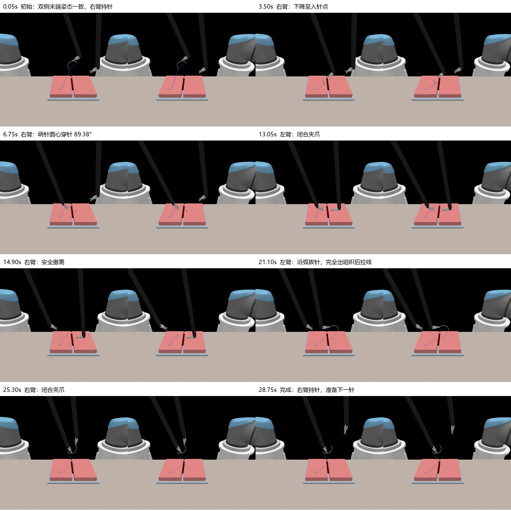

# 双臂缝合仿真 / Dual-arm suturing simulation

基于 MATLAB 与 CoppeliaSim 的双臂单针间断缝合运动学演示：右臂持针入针、左臂接针并沿圆弧拔针，再交回右臂。采用小幅近端运动与末端腕部控制，包含双目记录和碰撞检查。

## 演示视频与关键帧

[观看双臂缝合仿真演示视频（MP4）](docs/media/single_interrupted_suture_stereo.mp4) · [下载原始视频](https://github.com/Krist21a/dual-arm-suturing-simulation/raw/refs/heads/main/docs/media/single_interrupted_suture_stereo.mp4)

下图展示初始持针、下降入针、圆弧穿针、左臂接针、右臂撤离、沿弧拔针以及交回右臂的关键阶段；各阶段均展示双目视图。

## 运行

1. 安装支持 Java 的 MATLAB 与 CoppeliaSim（交付环境使用 CoppeliaSim 4.10）。
2. 在 CoppeliaSim 打开 `output/scenes/dual_DVRK_ARM_suture.ttt`，保持仿真停止。
3. 将 MATLAB 当前目录设为本仓库根目录，执行 `main_suture`。

程序扫描本机 ZeroMQ 端口 23000–23009；可通过环境变量 `COPPELIA_ZMQ_PORT` 优先指定端口。Remote API MATLAB 客户端及 JeroMQ 0.5.2 随仓库提供。场景中已嵌入 `SutureController`，不必运行场景构建脚本。

运行必须保留 `work/suture_review/wrist_plan.json` 和 `output/reports/suture_plan_validation.json` 的相对位置。程序校验轨迹 SHA-256 后执行，并更新 `output/reports/` 下的运行记录。录制帧写入系统临时目录 `codex_suture_video_final`。

## 内容

- `main_suture.m`、`RunSutureWristCycle.m`：缝合入口与控制流程。
- 根目录其他 MATLAB 文件：运动学、逆解、轨迹与 Remote API 支持代码。
- `output/scenes/dual_DVRK_ARM_suture.ttt`：完整双臂缝合场景。
- `work/suture_review/`：轨迹、规划与开发审查脚本。
- `work/scene_inspection/`：规划辅助函数与场景录制 Lua 源码。
- `output/reports/`：原有联调验证报告。
- `docs/media/`：演示视频与关键帧图。

Python 文件是原开发环境中的辅助脚本，保留了原 Windows 绝对路径；使用前需按本机调整路径并安装对应依赖（如 NumPy、SciPy、CoppeliaSim ZeroMQ 客户端、Pillow、imageio-ffmpeg）。正常 MATLAB 演示不依赖这些 Python 脚本。部分辅助脚本使用未随仓库提供的临时视频帧或运行日志。

## 验证与范围

已有联调报告记录了 563 帧运行检查、两次连续交接以及训练垫和相机位姿检查，详见 `output/reports/suture_validation_summary.txt`。这些是原环境的历史结果，上传整理时未重新执行仿真；整理时已确认运行轨迹与校验报告的 SHA-256 一致。

本项目演示针运动和双臂交接；缝线为可视化曲线，不含组织变形、线张力或打结力学。未包含其他穿环演示场景、CAD 原始装配、第三方 Python 安装目录或临时缓存。
