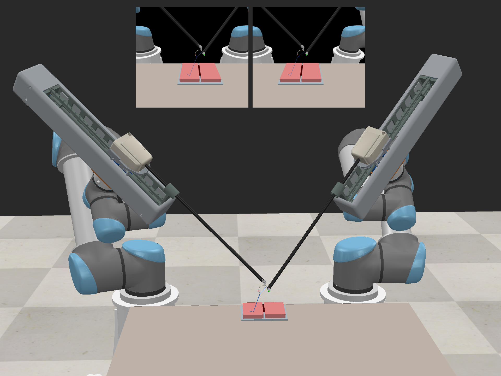
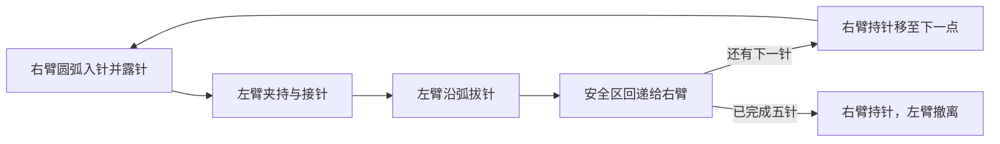
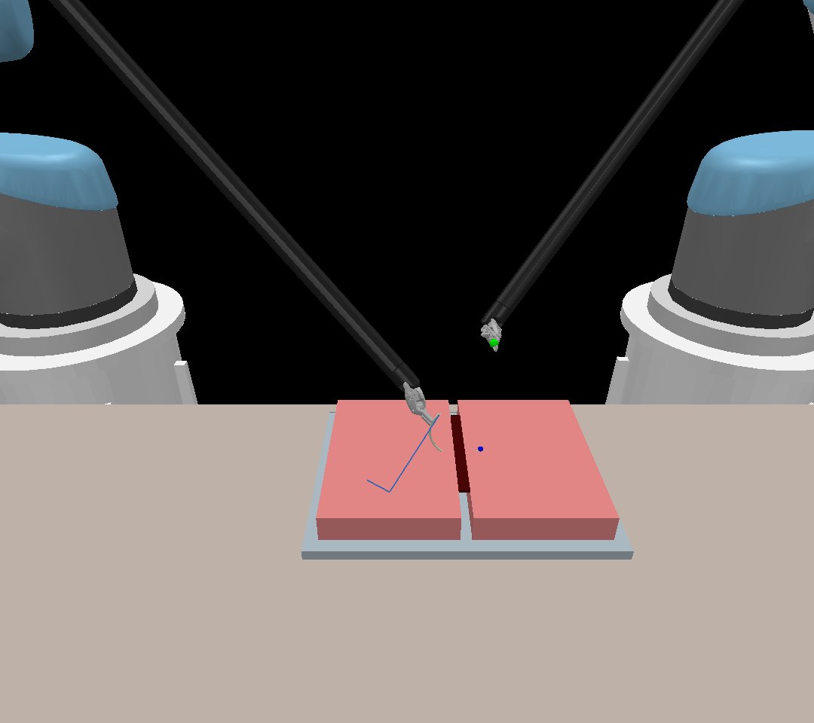
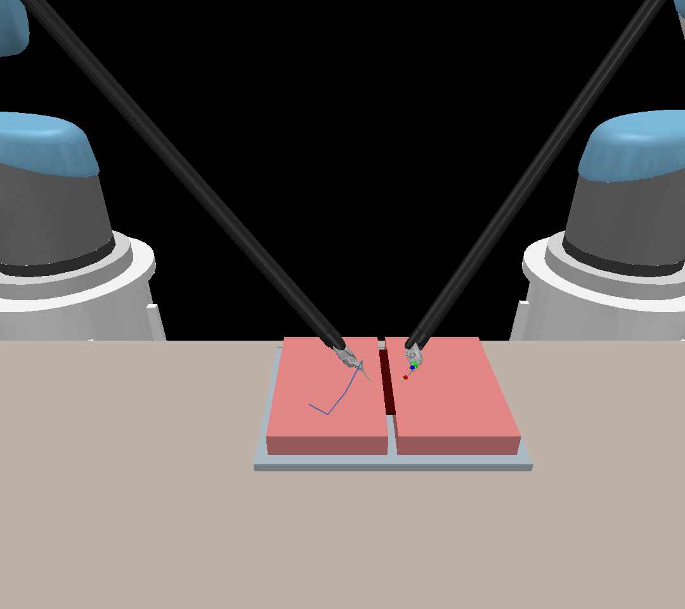
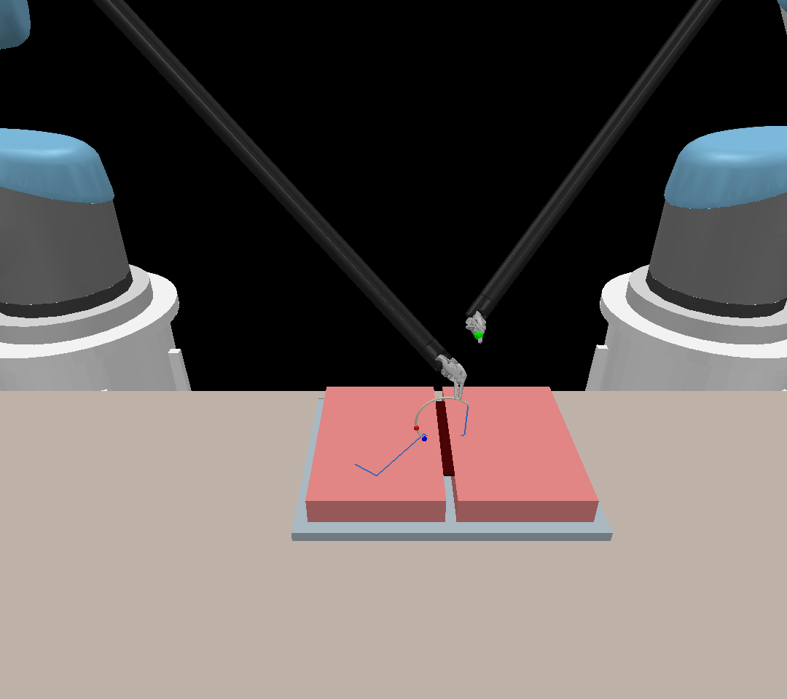
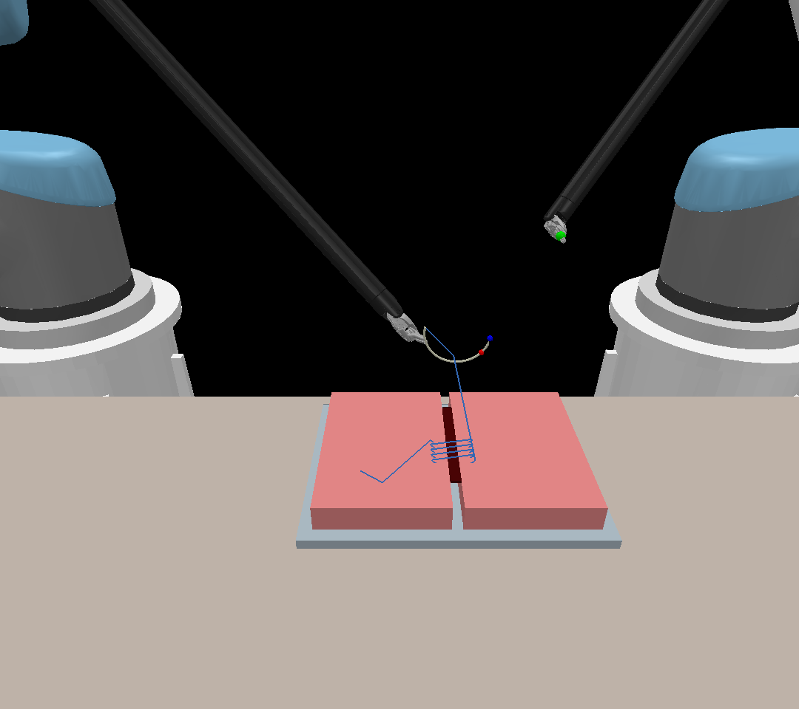

# 双臂连续缝合仿真

**Dual-arm Continuous Suturing Simulation**

我基于 CoppeliaSim、Python 和 MATLAB 搭建了这个双臂缝合仿真项目，将单针穿刺与双臂交接扩展为沿切口前进的连续缝合。当前版本可以在一次仿真中完成 **5 针、针距 3 mm** 的动作，并持续保留已经形成的缝线。

我在实现中重点处理了三件事：让弯针沿自身圆弧穿过训练垫，让两只机械臂在交接时保持针位连续，以及让上一针的结束状态自然衔接到下一针。

<p align="center">
  <strong>5 针连续缝合 · 3 mm 针距 · 10 次双臂交接 · 3,346 帧实跑检查</strong>
</p>

[](https://github.com/Krist21a/dual-arm-suturing-simulation/raw/refs/heads/main/docs/media/continuous_suture_5x3mm_overview_stereo.mp4)

**[观看 / 下载全景＋双目演示](https://github.com/Krist21a/dual-arm-suturing-simulation/raw/refs/heads/main/docs/media/continuous_suture_5x3mm_overview_stereo.mp4)** · [纯固定全景录像](docs/media/continuous_suture_5x3mm_overview.mp4) · [运行指南](docs/RUNNING.md)

*演示时长 2 分 47.9 秒，1920×1440、20 fps。上方两个画面分别来自原有左、右相机，与下方全景逐帧同步，播放速度保持不变。*

## 我做了怎样的仿真场景

我把两只机械臂布置在工作区两侧，让肩肘支撑在各自一侧，器械杆向前下方伸入缝合区域。训练垫固定在桌面上，左右双目相机保持固定位置，轨迹规划需要在这套布局下完成整个动作。

在控制上，我保留了原有两片夹爪的几何、关节轴和开合配对，让末端腕部承担主要的穿刺与拔针运动，同时限制大臂在工作过程中的变化。这样可以同时观察到整机姿态、器械之间的空间关系和针在局部区域的运动。

| 场景组成 | 我在项目中的安排 |
| --- | --- |
| 双臂分工 | 右臂持针入针，左臂接针拔出，再交回右臂 |
| 弯针运动 | 使用拟合半径约 11.375 mm 的弯针，绕针圆心旋转穿刺 |
| 训练垫与切口 | 训练垫固定，五针沿切口前进，首尾跨度 12 mm |
| 夹持与交接 | 用跟随实际夹持姿态的坐标系挂接针，交接保持世界位姿连续 |
| 观察方式 | 固定全景展示整机，双目视图展示针、器械末端和缝线 |

## 从一针到连续五针

我先完成了单针动作：右臂准备、圆弧入针、露针、左臂接针、拔针，再交回右臂。在扩展到多针时，我把这个过程组织成一段连续执行的状态机，让右臂从上一针的持针终态移动到下一针起点。

每针之间不重新初始化仿真，也不重设针的世界位姿。已经形成的组织内线段继续保留，并与下一针连接；当前演示整段不断线，不额外打结。



### 实际运行中的关键画面

下面四张图均取自本次五针仿真的左相机原始帧，未裁切或添加标注。它们展示了我关注的局部动作，以及连续缝线最终保留下来的状态。

<table>
  <tr>
    <td width="50%"></td>
    <td width="50%"></td>
  </tr>
  <tr>
    <td><strong>① 圆弧入针</strong><br>我让针绕圆心旋转，并保持针平面与训练垫表面垂直。</td>
    <td><strong>② 双臂接针</strong><br>左臂到位并闭合后再完成交接，针在世界坐标系中的位姿连续。</td>
  </tr>
  <tr>
    <td></td>
    <td></td>
  </tr>
  <tr>
    <td><strong>③ 进入下一针</strong><br>右臂带针沿切口前进 3 mm，上一针的缝线持续保留。</td>
    <td><strong>④ 五针完成</strong><br>五段穿线及针间连接保留，终态为右臂持针、左臂张开撤离。</td>
  </tr>
</table>

帧号、动作阶段和仿真时间记录在 [配图来源](docs/media/continuous_readme_frames.json) 中。

## 我重点处理的几个问题

**保持自然的肩肘布局。** 我将两臂的肩肘分支保留在工作区两侧，通过夹针位置、末端姿态与交接位置的配合完成任务。工作中的大臂变化与初始化时的姿态调整分别记录，避免把两个指标混在一起。

**让弯针沿圆弧穿刺。** 入针到出针采用约 89.384° 的圆心旋转，随后继续露针，为左臂接针留出空间。针平面保持竖直，器械姿态需要适应这个约束。

**处理连续交接与针间过渡。** 我将夹爪闭合、针的父坐标系切换、另一侧夹爪松开拆成明确的阶段，并检查交接前后的针位姿。多针之间延续右臂持针状态，已有缝线不会随下一针开始而被清除。

**让执行过程可以复核。** 我记录每帧的实际关节位置、针位姿、碰撞结果以及训练垫和相机位姿；录制双目画面后，再与全景运行逐帧核对，确认画面对应同一动作状态。

## 我如何验证结果

下表对应当前 **5×3 mm** 方案的实际运行记录。碰撞结果指本场景、当前轨迹和所检查对象在采样帧上的检测结果。

| 检查项目 | 本次结果 |
| --- | --- |
| 实跑检查帧数 | **3,346 帧** |
| 双臂、训练垫、桌面及非相邻臂杆碰撞 | **未检测到碰撞** |
| 双臂交接 / 针间过渡 | **10 次 / 4 次**，针位连续 |
| 仿真时间推进 | 每帧 **0.05 s** |
| 针平面最大偏离竖直 | 约 **0.00104°** |
| 左 / 右大臂相对实际初始姿态最大变化 | 约 **2.35° / 3.19°** |
| 关节行程 | joint7、joint8、joint9 均在允许范围内 |
| 训练垫与原双目相机 | 位姿保持不变 |
| 全景与双目动作帧核对 | **3,346 帧一致** |

完整数据见 [验证摘要](output/reports/continuous_suture_validation_summary.txt)、[详细实跑报告](output/reports/continuous_suture_final_validation.json) 和 [双目同步报告](output/reports/continuous_suture_stereo_inset_validation.json)。发布版入口也重新完成了全部动作检查，见 [发布版实跑报告](output/reports/continuous_suture_github_runtime_validation.json)。

此外，我保留了无需启动仿真器即可运行的回归测试，检查轨迹校验值、针距、运动学目标、关节限位和竖直圆弧入针：

```bash
python -m unittest discover -s tests -v
```

## 在你的电脑上运行

验证环境为 **CoppeliaSim Edu 4.10 + Python 3.13**，也提供 MATLAB 入口。建议使用不含中文或空格的仓库路径，以兼容部分仿真器文件接口。

```bash
python -m pip install -r requirements.txt
```

1. 在 CoppeliaSim 打开 `output/scenes/dual_DVRK_ARM_continuous_suture.ttt`，保持仿真停止。
2. 将 `COPPELIA_ZMQ_PORT` 设置为仿真器实际端口。程序默认 `23002`；若仿真器使用 `23000`，需相应修改。
3. 在仓库根目录运行：

```bash
python work/continuous_suture/run_native.py
```

使用 MATLAB 时，运行 `main_suture` 或 `main_continuous_suture`，它们会调用同一个 Python 执行器。Python 路径配置、视频录制、存储空间和参数修改步骤见 **[完整运行指南](docs/RUNNING.md)**。

## 仓库结构

```text
├── main_suture.m                    # 默认多针入口
├── main_continuous_suture.m         # 多针 MATLAB 入口
├── main_single_suture.m             # 单针对照入口
├── work/continuous_suture/          # 多针规划、状态机、检查与录制
├── output/scenes/                  # 多针场景与保留的单针场景
├── output/reports/                 # 轨迹、实跑与视频验证记录
├── docs/media/                     # 演示视频和真实仿真配图
└── tests/                          # 无需仿真器的轨迹回归测试
```

`work/suture_review/` 和 `work/scene_inspection/` 保留了单针基线与规划辅助代码，其中部分历史调试脚本仍带有原开发环境配置，不作为默认运行入口。

## 当前实现的范围

我将这一阶段的项目定位为**双臂连续缝合的运动学仿真**：执行规定的关节轨迹，开启网格碰撞检查，动力学求解关闭。缝线用于呈现连续穿线过程，尚未包含组织变形、线张力、力控制或打结力学。

因此，这里的画面和数据说明的是当前仿真场景中的动作与几何约束。后续可以在这套连续状态机和验证记录的基础上，继续扩展缝线张力、组织模型和基于视觉的闭环控制；这些方向不计入当前已实现功能。
