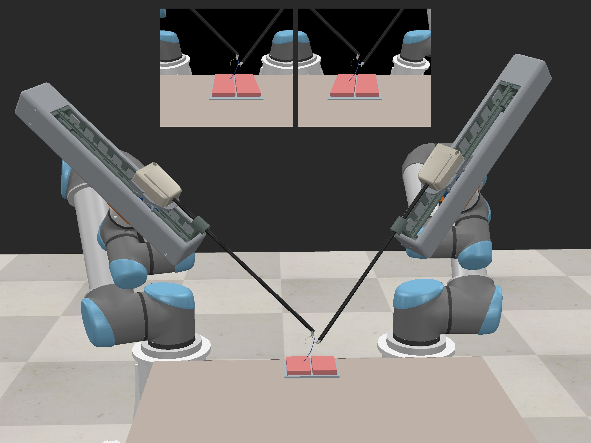

# MATLAB 双臂连续缝合仿真

我基于 MATLAB、CoppeliaSim 和 Python 搭建了这套双臂缝合原型。当前入口从 MATLAB 逐步发送控制指令，让双臂完成 **5 针、3 mm 针距** 的连续缝合，并在运行中计算针刺压入、组织变形和拉线收口。

我把持针位置调整到了夹爪内侧约 3 mm，保留原夹爪几何与关节轴；缝线从第一条指令开始存在，随针移动，已经形成的线段持续保留。普通连续缝合整段不断线，不额外打结。

[](https://github.com/Krist21a/dual-arm-suturing-simulation/raw/refs/heads/main/docs/media/soft_suture_natural_3x_clean.mp4)

**[下载最小 MATLAB 在线仿真包](https://github.com/Krist21a/dual-arm-suturing-simulation/raw/refs/heads/main/docs/downloads/matlab_suture_3x_minimal.zip)** · [运行说明](demo/matlab_suture_3x/README.md) · [参考视频](docs/media/soft_suture_natural_3x_clean.mp4)

参考视频为 59.15 秒、1920×1440、20 fps，仅拼接全景和上方中央左右目画面。它来自此前细步长求解结果的三倍速播放；当前 MATLAB 入口则按加速后的控制指令在线重新求解，局部变形与受力数值允许存在差异。

## 在 MATLAB 中运行

我已用 Windows、MATLAB R2022a、CoppeliaSim Edu 4.10 和 Python 3.13 跑通完整流程。最小包无需完整开发仓库。

1. 安装 Python 依赖：`python -m pip install -r demo/matlab_suture_3x/physics/requirements.txt`。在最小包中对应 `physics/requirements.txt`。
2. 打开 CoppeliaSim，保存当前工作并停止仿真。
3. 在仓库根目录或最小包根目录的 MATLAB 命令窗口运行：

```matlab
main_suture('C:/你的Python路径/python.exe', 23000, 35)
```

Python 已加入 PATH 时可直接运行 `main_suture`。端口默认 23000，第三个参数为组织网格弹簧刚度（N/m），不是材料杨氏模量。修改它会改变本次计算的组织响应。MATLAB 不需要配置 `pyenv`；本机 Python 进程只提供力学计算，动作控制与仿真步进由 MATLAB 主循环负责。

1170 条指令、每条 0.05 s，覆盖约 58.5 s 仿真时间。实际运行耗时取决于求解与渲染性能，不保证墙钟实时。结束后场景暂停，重跑前先停止仿真。

## 我如何组织控制与物理


`commands.json` 只存控制目标、动作阶段和针次，不含预计算的垫子或缝线运动。在线场景没有 `SoftSuturePlayback` 播放器。材料状态由每次启动的新求解器建立，每条指令内部进行六次力学积分。

组织采用非线性弹性点阵、体积惩罚、接触边界与 Kelvin–Voigt 黏性阻尼；针刺采用平滑压力分布和阈值释放近似。缝线是连续的准静态无质量缆索，使用总长度约束传递张力，并根据余量生成下垂与表面支撑形态。

| 右臂持针 | 左臂持针 |
| --- | --- |
|  |  |

## 实际运行证据

| 检查 | 可复核文件 |
| --- | --- |
| MATLAB 完整在线控制、关节读回、碰撞、最终组织状态 | [运行报告](output/reports/matlab_online_validation.json) · [MATLAB 日志](output/reports/matlab_online_run.log.txt) |
| 刚度 35 与 70 N/m 导致不同的实时组织响应 | [材料参数对照](output/reports/online_material_response_validation.json) |
| 在线运行的逐步物理结果 | [在线指标](demo/matlab_suture_3x/online_metrics.json) |
| MATLAB 实际运行截图 | [初始](demo/matlab_suture_3x/online_0001.png) · [抽针](demo/matlab_suture_3x/online_0145.png) · [收口](demo/matlab_suture_3x/online_1170.png) |
| 参考视频及组织回弹/时间步检查 | [视频报告](output/soft_suture_natural_3x/video/validation.json) · [力学报告](output/soft_suture_natural_3x/natural_validation.json) |
| 最小包完整性与发布资产对应关系 | [压缩包校验](output/reports/matlab_online_package_validation.json) · [文件哈希清单](output/reports/matlab_online_published_assets.json) |

## 源码与历史结果

`demo/matlab_suture_3x/` 是可独立运行的最小链路：MATLAB 主程序、接口依赖、三个 Python 力学文件、控制目标、场景、场景内 Lua 源码和参考视频。`work/soft_suture/` 保留完整建模、轨迹修正、录制、验证、打包与在线控制实现。`output/` 保留对应计算数据、场景和证据；旧单针及运动学版本仍可用于对照。

我把当前版本定位为可复现的研究原型。机械臂按位置轨迹控制，针与夹爪采用几何约束；尚未实现机器人力反馈、夹持接触力、真实切割、线组织摩擦、线自碰撞或打结。组织参数没有经过材料实验标定，输出受力不能等同于实测手术力。
