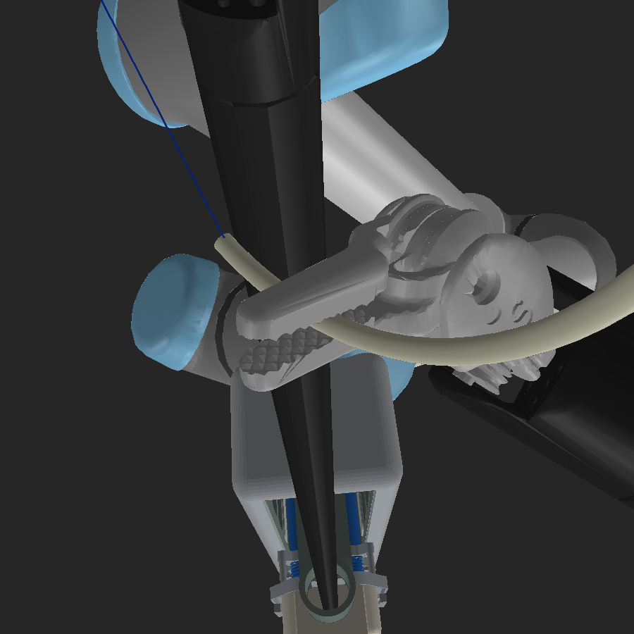
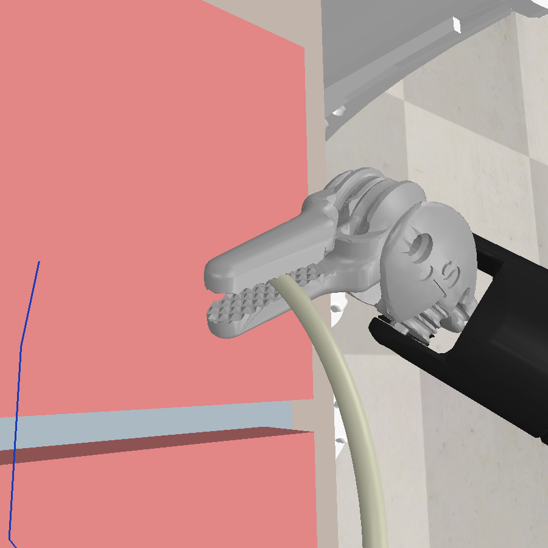

# 双臂缝合：软组织与缝线张力原型

我在原来的五针连续缝合演示上加入了组织受力变形与缝线拉力传递。当前场景为 `output/scenes/dual_DVRK_ARM_soft_suture_continuous_thread.ttt`，包含持续可见的缝线和夹爪内侧持针；早期场景 `dual_DVRK_ARM_soft_suture.ttt` 继续保留。

## 三倍速与自然变形版本

我新增了 `dual_DVRK_ARM_soft_suture_natural_3x.ttt`。该场景以原来三倍的速度播放；组织仍按 0.025 s 步长求解，再抽取播放状态，加速不会改变材料求解时间尺度。

我为组织加入立方应变硬化与沿网格边的 Kelvin–Voigt 黏性阻尼，并用连续压力分布替代突然切换的单节点压入。缝线根据求解器中的余量生成重力下垂曲线，并受到组织表面支撑；拉紧时余量消失，线形趋于绷直。这仍是全局长度约束下的准静态缆索，不包含动态细杆、摩擦和自碰撞。

```powershell
python work/soft_suture/simulate.py --natural --output output/soft_suture_natural
python work/soft_suture/prepare_natural_3x.py
python work/soft_suture/build_scene.py --data output/soft_suture_natural_3x --scene-name dual_DVRK_ARM_soft_suture_natural_3x.ttt --preview-only
```

此流程复用上一版 `output/soft_suture_continuous` 中的夹持修正轨迹。`natural_validation.json` 检查网格翻转、固定边界、针眼连接及两种时间步下的压入回弹。录制时设置 `SOFT_DATA_DIR`、`SOFT_SCENE_PATH`、`SOFT_VIDEO_PATH` 指向新版数据、场景和视频，并将 `SOFT_CLEAN_FRAME_DIR` 指向独立的英文路径图片目录，再运行 `record_clean_video.py`。

## 两种运行方式

**直接看结果**：在 CoppeliaSim Edu 4.10 中打开新场景并点击运行。场景内嵌了机械求解结果，不依赖外部录像或数据文件。这里播放的是计算结果，不会因鼠标拖动自动重新求解。

**重新计算并同步显示**：安装依赖，打开新场景并保持停止，然后在项目根目录运行：

```powershell
python -m pip install -r work/soft_suture/requirements.txt
python work/soft_suture/live.py --port 23000
```

默认代码端口为 23002；普通 CoppeliaSim 的默认远程接口通常是 23000，请按实际设置选择。实时模式每一步重新求解组织与缝线，计算速度取决于电脑；双臂动作仍来自既定轨迹，尚未实现力反馈控制。

修改组织弹性示例：`python work/soft_suture/live.py --port 23000 --stiffness 70`。这里的刚度是单根网格弹簧的 N/m，不是材料杨氏模量。

重新生成独立场景：

```powershell
python work/soft_suture/simulate.py
$env:COPPELIA_ZMQ_PORT="23000"
python work/soft_suture/build_scene.py
```

场景生成器会在已停止的仿真窗口载入原连续缝合场景，再保存新场景。使用前请保存窗口中自己的其他编辑。原 `.ttt` 文件不会被覆盖。

## 我采用的模型

- **组织**：两块三维弹性点阵，含质量、阻尼、重力、弹簧弹性与四面体体积惩罚。外侧和纵向两端固定，底部有托盘接触约束；切口两侧保留 0.3 mm 接触间隙，避免彼此穿透。用隐式时间积分求解力学平衡，不按动画曲线移动组织顶点。
- **针尖穿刺**：以有限半径压头近似针尖接触。组织先凹陷，反力超过设定阈值后释放该处针尖接触，记录穿刺事件。针本身由机械臂按位置轨迹驱动，计算反力不会使机械臂主动停下。
- **缝线**：一根有有限拉伸刚度、只能承受拉力的准静态无质量缆索。总长度与材料导向点共同决定张力，拉力参与同一个组织求解。缝线可无摩擦地经过导向点；它不是五根分别缩短的独立线。
- **连续送线**：每针抽出后增加一个近似穿刺通道。铺线阶段由理想送线器保持少量余线，拉紧阶段固定线长，右臂向上提拉 100 mm。起始线尾设为固定夹持边界；没有自动打结。
- **接触边界**：0.3 mm 是数值接触裕量，因此“闭合”表现为两边靠近此间隙，不强行让顶点重合。

当前导向点是组织材料点上的表面近似，并不重建针实际走过的三维针孔。针尖压头、送线器和线尾固定边界都是明确的简化假设。

## 验证

`output/soft_suture/mechanics_validation.json` 包含无拉线对照、减半步长对照、网格翻转检查、固定边界检查与压入后回弹检查。`scene_validation.json` 记录 CoppeliaSim 播放时的机械臂和原刚性环境轮廓碰撞检查；它不代表对变形组织与整个器械接触的完整验证。

```powershell
python work/soft_suture/simulate.py --no-pull --output output/soft_suture/control_no_pull
python work/soft_suture/simulate.py --dt .0125 --output output/soft_suture/control_half_dt
python work/soft_suture/validate.py
```

## 目前的边界

这是可复现、可调参数的简化力学原型。尚未包含真实切割/裂纹扩展、线与组织摩擦、线的弯曲和扭转、线自身碰撞、打结以及机器人力控。组织体积惩罚也不等同于严格不可压缩组织，报告中保留了各单元的体积比供检查。材料参数与穿刺力阈值没有经过硅胶或人体组织实验标定，不能把输出牛顿数当作实测结果。

## 文件

`mechanics.py` 是力学核心，`trajectory.py` 复用原双臂运动并求解拉线动作；`simulate.py` 生成结果，`live.py` 同步求解与显示，`build_scene.py` / `playback.lua` 生成独立演示场景。`capture.py` 输出实际场景渲染。

## 连续可见缝线与夹持位置修正

我将针的夹持位置从夹爪末端向内移约 3 mm，并调整器械方向，让针体横过两片夹持面。双臂关节轨迹重新求解，针的运动轨迹和组织力学结果保持不变。这里修正的是夹持几何与运动关系，尚未加入夹爪与针之间的接触力求解。

右臂围绕夹持点调整 30° 倾角，左臂采用 15° 斜向夹持，以避免器械腕部或杆端碰到垫子。最终场景的 3506 帧已通过原环境轮廓碰撞检查；夹持特写也按实际关节读回结果核对。

| 右臂持针 | 左臂抽针后持针 |
| --- | --- |
|  |  |

缝线从第一帧就连接在线尾与针眼之间；抽针时逐步铺设新的穿刺通道，已完成的部分持续保留。表面导向点的显示位置上移 0.15 mm，避免与组织表面重合闪烁；力学求解位置不变。

```powershell
python work/soft_suture/simulate.py --output output/soft_suture_continuous
python work/soft_suture/retarget_grasp.py
python work/soft_suture/apply_grasp_clearance.py
python work/soft_suture/apply_grasp_clearance.py --left
python work/soft_suture/validate_continuous_thread.py
python work/soft_suture/build_scene.py --data output/soft_suture_continuous --scene-name dual_DVRK_ARM_soft_suture_continuous_thread.ttt --preview-only
python work/soft_suture/check_centered_grasp.py
python work/soft_suture/record_clean_video.py
```

后两步默认连接端口 23002。录制时将 `SOFT_CLEAN_FRAME_DIR` 设为可写的纯英文路径（也可以是指向项目输出目录的目录联接），以兼容仿真器的图片保存接口。录像生成在 `output/videos/soft_suture_continuous_thread_clean.mp4`，只拼接全景与上方中央左右目画面，不添加文字或慢放片段。连续缝线、实际夹持位置和逐帧关节/环境碰撞检查分别保存在 `output/soft_suture_continuous` 及其 `video` 子目录中。

## 早期带说明的视频

```powershell
$env:COPPELIA_ZMQ_PORT="23000"
python work/soft_suture/record_video.py
```

输出为 `output/videos/soft_suture_5x3mm_overview_stereo.mp4`：1920×1440、20 fps，先播放完整五针过程，再回看穿刺变形的 1/3 速特写和拉线收口的 1/2 速特写。左右目窗口位于全景上方中央，每个窗口为 432×384，保持原相机位置与视场角。

录制在场景副本中逐步推进，并明确应用每帧关节目标，避免暂停切帧时旧的静止控制状态覆盖机械臂姿态。每帧检查实际关节、工具位姿、针位姿与原环境轮廓碰撞，再从同一状态采集全部相机。图像在内存中传给编码器，不生成大量原始 BMP 文件。录制报告位于 `output/soft_suture/video/validation.json`。
